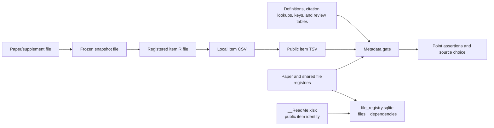

# File-level registration for the ten-paper pilot

Each paper folder now has `pipeline_files.csv` (one row per physical file) and
`file_dependencies.csv` (one row per confirmed relationship between files).
These are the editable paper-local registries. The older
`metadata_sources.csv` files are retained as ancillary comparison views and
are not read by the active pilot. `__ReadMe.xlsx` still registers public
item identities and encoded TSV names; it is not the register for every
supporting metadata file.



Every box representing a physical input, script, or output has a file row;
confirmed arrows are keyed in `file_dependencies.csv` or
`shared_pipeline_dependencies.csv`. Field-to-value evidence remains in the
route and assertion tables, at its actual locator precision.

## What a file row means

`file_id` is stable and unique across the pilot. Where the earlier catalog
already had an `artifact_id` for the same path, that ID was reused so field
routes can join directly. `path` is repository-root relative and unique.
`item_id` links to a live public item where applicable; it is blank for
paper-wide resources. The remaining fields serve different purposes:

| Field | Purpose |
| --- | --- |
| `file_role` | Source document/table, snapshot, item builder/CSV/TSV, metadata table, support script, pipeline output, documentation, or manifest. |
| `content_role` and `record_grain` | What the file contains and what one record represents. |
| `creation_mode` | External, byte-copied, transcribed, manually curated, generated, or unknown. |
| `stage` | Where it participates in the workflow. |
| `authority_status` | Resource-level status such as source evidence, project definition, proposal, or curated authority. |
| `producer_id` | File ID of the script actually known to create this file; blank when unsupported. |
| `lifecycle_status` | Active, ancillary, or retired in this pilot. Active does not approve its rows or claims. |

The separate dependency table has `output_file_id`, `input_file_id`,
`relation`, `source_locator`, and `note`. Inputs and producers use file IDs,
not comma-separated paths. A dependency is added only when the script or
source documentation establishes it. Point-level evidence and review still
belong in `point_assertions` and `assertion_evidence`.

`Rscript __metadata/pilot/build_file_registry.R` combines the ten paper
registries with the shared register into `file_registry.csv`,
`file_dependencies.csv`, and `file_registry.sqlite`. The SQLite database has
foreign keys for public items, files, producers, dependencies, and 523
file-backed metadata routes. The three older `__merging_*` route artifacts
stay outside this no-merge file registry.
The builder scans every non-hidden file in the ten paper folders and every
file in the three shared pilot directories. Shared legacy outputs, interrupted
temporary databases, and `.gitignore` have explicit patterns and reasons in
`shared_pipeline_exclusions.csv`; a new unexplained file fails validation.

The builder also writes `file_registration_issues.csv`: 20 active snapshots
whose creation mode is still unknown and 45 manually curated paper metadata
tables without a confirmed source-file edge and locator. These files are
registered; their provenance details need review. A file-level source edge
will not replace the per-row evidence check in the assertion audit.

For example, from R, the combined registry can answer where Mink Table 1's
citation metadata lives:

```r
con <- DBI::dbConnect(RSQLite::SQLite(), "__metadata/pilot/file_registry.sqlite")
DBI::dbGetQuery(con, "SELECT metadata_field, path, file_role, locator
  FROM metadata_evidence_route
  WHERE item_id = 'Mink_etal_1981_TABLE1'
    AND metadata_field IN ('upstream_reference', 'item_definition')")
DBI::dbDisconnect(con)
```

For the older three-way metadata classification, `item_csv` is a registered
matrix; source tables, snapshots, metadata tables, and tabular pipeline
outputs are unregistered matrices; documents, support scripts, and narrative
notes are other unregistered resources. Item builders and public TSVs have
their own file rows, rather than being hidden in columns of a matrix row.
Registration class, file role, and authority remain separate.

## Coverage and known limits

The ten paper manifests contain 315 files and 148 confirmed dependency edges.
They include all 39 registered item R builders, local CSVs, and public TSVs;
all 47 supporting metadata CSV files now in paper-local `reference_tables`; the 192 resources
from the previous metadata manifests; the manifests themselves; and 15
ancillary or retired files. The validator scans every non-hidden physical
file in the ten paper folders. Of 37
frozen snapshots, 13 have an inspected writer script recorded as producer,
three are documented transcriptions, one is a documented byte-identical
copy, and 20 retain `creation_mode=unknown`. An unknown producer is preferable
to inventing a build edge. This is a file and build registry, not yet a
complete publication-row lineage for every measurement.

For example, Mink `REFERENCES` has separate file rows for its frozen
bibliography transcription, registered item R builder, local CSV, and public
TSV. Its Table 1 citation lookup is a separate unregistered metadata-table
row with the Table 1 builder as producer. Fobbs's seven Word supplements,
snapshot writers, snapshots, item builders, and TSVs likewise have separate
rows; their paper-local taxon annotations remain distinct metadata tables.

## Migration and checks

From the repository root:

```sh
python3 __metadata/pilot/register_pipeline_files.py validate
python3 __metadata/pilot/validate_metadata_tables.py
```

The validator checks file IDs, paths, controlled fields, producers,
dependencies, all non-hidden files in the ten paper folders, and
one registered R/CSV/TSV chain per live item. It also checks that deriving
the old metadata source view loses no paths, content roles, record grains,
authority statuses, related item links, or notes. The old resource IDs
intentionally change to existing catalog artifact IDs for 189 paths.
The metadata-table validator enforces the paper-local placement, scope and
type suffixes, and stable table headers for the 47 supporting CSVs; it reports
unresolved publication locators without guessing them.

`seed --force` is a **migration reset**: it rebuilds the ten editable file
registries from the old manifests and will overwrite later curation, so it
should not be used during routine builds. The older manifests remain
manually curated, ancillary comparison files. The default `derive-legacy`
mode compares them to a view of the new registry. Its `--force` option can
regenerate them if a later migration deliberately adopts generated
compatibility files; doing so is not part of the active pilot.
