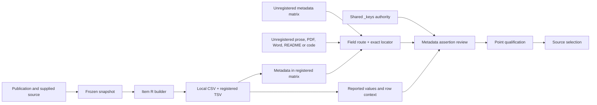

# Metadata registration policy for the ten-paper pilot

Registration, content, and evidentiary authority answer different questions.
`__ReadMe.xlsx` registers a reproducible **public item matrix**. It does not certify
that every field is a biological measurement, that a taxon identification is
accepted, or that the publication originally measured every cited value.
Conversely, a metadata file without public-item registration can be mandatory evidence for a
qualified report. The same registered matrix can carry measured values,
citations, methods, specimen descriptions, and project-derived annotations.

## One paper-folder contract

Each paper folder now has `pipeline_files.csv` and `file_dependencies.csv`.
Every active source, script, snapshot, support table, registered item CSV, and
public TSV gets a distinct file ID and a creation mode. The live item registry
remains the authority for which matrix is a public item. Each public item
retains its source/snapshot → item R builder → local CSV → encoded TSV chain.
For metadata use, the file register derives the familiar three carrier
classes:

| Class | Meaning | Pilot examples |
| --- | --- | --- |
| `registered_matrix` | Its own `__ReadMe.xlsx` item, R builder, local CSV, and public TSV. It may contain data, metadata, or both. | Mink REFERENCES; Fobbs S1a–S5b; Kennedy Text; ManyPrimates predictors. |
| `unregistered_matrix` | A CSV, workbook, or other table that supplies definitions, lookups, decisions, or checks but has no independent item registration. | Kennedy Text references; Fobbs S2/S4/S5b taxon lookups; Heffner citation-scope table; item definitions. |
| `unregistered_other` | Located evidence or project explanation in prose, a PDF, Word supplement, README, or code. | Kennedy Methods and bibliography pages; Fobbs Word supplements; Boddy source notes. |

The class is about **public-item registration and carrier**, not importance
or approval. Every carrier is registered in the file-level pipeline register;
only some are also public items in `__ReadMe.xlsx`. `creation_mode`,
`content_role`, `record_grain`, and `authority_status` are separate fields.
A source may serve more than one field; the catalog's `field_routes`
table records those uses with a target item, locator, granularity, and
checkpoint. A paper-local definition or taxon judgment remains distinguishable
from a shared `_keys` decision even if both are CSV files.

## When a metadata matrix should be registered

Register a metadata matrix as its own item when it is an independently
identifiable source locus with a stable row identity, a frozen source, an R
builder, a local CSV, and an encoded TSV that users may cite or reuse as a
matrix in its own right. Registration is **not** a reward for importance.
Keep a projection or project decision unregistered when its identity depends
on another registered item or when registering it as a publication table
would imply an origin the source does not have. Record its producer, input,
join key, and source locator, and require it in the metadata route.

| Case | Current treatment | Pilot decision |
| --- | --- | --- |
| Mink REFERENCES | Registered bibliography matrix built by R from a frozen bibliography snapshot. | Keep registered; its 54-key TABLE1 lookup remains an unregistered derived matrix. `Data role=secondary` in the registry does not describe bibliography entries. |
| Fobbs S1a–S5b | Seven registered museum catalogs; S1a also has body lengths. | Keep registered. Distinguish Fobbs's role as catalog publisher from the unknown original measurer of archived lengths; the three project taxon lookups remain unregistered. |
| ManyPrimates predictors; Boddy raw database; Heffner Table 1; Bahney Tables 3–4; Kennedy Text | Registered matrices with metadata fields beside reported values. | Keep one item per source matrix. Use row/column/cell routes for citations, methods, and source roles; do not register a second copy just to extract those fields. |
| Kennedy Text references 20/22 | Two-row lookup derived from the paper bibliography for the Text item. | Keep unregistered; route each printed number to its cited work. Ref 22 is a review chapter, with the originating measurement still unresolved. |
| Kaufman shared references table | Project lookup used by several registered appendix items. | Keep unregistered in this pilot. Consider a separate registered bibliography item only if a complete, frozen bibliography source and independent R→CSV→TSV build are prepared; the current lookup alone does not establish that. |
| Definitions, proposed taxon keys, errata, citation-scope declarations, source-match outputs | Project-authored interpretation, review proposal, or generated check. | Keep unregistered and cataloged. The source and review status must be explicit; proposed keys and errata are not active authority. |
| Buchsbaum Text; Kaufman Table A15 | Registered derived or restated matrices omitted from the earlier 24-item catalog. | Include in the folder-wide 39-item inventory, with derivation role. Registration does not make their rows independent observations. |

For a later revision of `__ReadMe.xlsx`, add `Item content role`, `Record
grain`, and `Value-role scope` (`item`, `column`, `row`, `cell`, or
`not_applicable`). The existing `Data role (primary/secondary/both)` field
should describe values only when its scope is explicit. A bibliography
should have `not_applicable`; a mixed table should point to its row/column
role field, rather than use `both` as though every cell had both origins.
The file registries provide a reviewable pilot of these fields without
changing the workbook's project-wide schema yet.

## Review rule for each final point

The gate must resolve measure/unit, printed and accepted taxon, reporting
reference, original or cited source role, upstream reference when secondary,
method, anatomy or behavior target, trait definition, and any transformation.
Each assertion needs a subject at item/column/row/cell grain, an evidence
resource and exact locator, a review state, and a responsible decision.
`review` is a state of knowledge or a publication genre; `primary` and
`secondary` describe where the **value** originated. A review chapter can
relay a primary measurement without becoming that primary source.

| Checkpoint | Required fields and evidence | Pass condition |
| --- | --- | --- |
| Registered extraction | Item ID, R builder, local CSV, encoded TSV; source snapshot and printed locator. | Every candidate value points to one live registered item and its source cell. |
| Definition | Measure, unit, statistic/basis, anatomy or behavior target, trait definition; matrix header plus item-scoped definitions or publication text. | Meaning and unit are explicit and consistent with the source cell. |
| Citation trace | Reporting work, source role at the value's grain, and cited upstream work for a secondary value; source column, registered bibliography, unregistered lookup, or publication bibliography. | Printed citation is resolved and primary/secondary assignment has cell/row evidence. |
| Method | Original acquisition and any transformation; methods prose, footnote, source paper, or method definition. | Required methods are identified or the point remains held. |
| Taxon | Printed name, source-snapshot name, accepted species, and decision basis; paper-local annotations plus shared `_keys` authority. | The accepted species is supported at the value's grain; a proposed paper-local mapping alone cannot pass. |
| Qualification and choice | Field statuses, blockers, lineage, and source-choice candidates. | All mandatory fields pass before a primary preference or aggregation decision. |

Each checkpoint applies whether its evidence is a public registered matrix,
another pipeline-registered matrix, or a pipeline-registered document. A source resource can be
reviewed once, but its claim still needs a scope and a decision for the value
or field that uses it. The file registries inventory evidence; the report
gate decides whether a particular point can pass.

The normalized output separates a field claim from its potentially multiple
pieces of evidence. The pilot `point_assertions.csv` has `assertion_id`,
`point_id`, `field_name`, `value_text`, `pilot_status`,
`qualification_pass`, `applicability_scope`, and `derivation_rule`.
`assertion_evidence.csv` has `assertion_id`, `artifact_id`, `work_id`,
`evidence_path`, `locator`, `evidence_relation`, `locator_precision`, and
`link_status`. Its SQLite mirror enforces the point, assertion, and artifact
links. `pilot_status` is the existing gate's semantic assessment;
`link_status` is the precision of this evidence link. Neither is a new
human approval. A later adjudication layer should add the reviewer,
review date, and explicit assertion decision. The point ID links to the
registered value cell; evidence links may point to a registered matrix, an
unregistered table, or located publication prose. A source key and the
resolved cited work are separate fields:
one printed `ref 20` may resolve to a bibliographic work, while its exact
relation to a value still needs a row- or cell-scope check. For Fobbs S2,
the `Species_binomial` assertion would point to the unregistered taxa row,
not merely to the registered TSV that carries the resulting annotation.
For Kennedy Text, each secondary value would point to its own `cited_ref`
cell and the corresponding numbered-reference lookup; its `data_role` row
is separate evidence for source role.

The current `field_routes.csv` says **where to look**; it is not itself a
table of adjudicated assertions. The assertion audit serializes the current
gate's claims and their known evidence, including explicit item-level leads
and unresolved links. Future paper builders should emit assertion and issue
tables at snapshot processing time so the R gate reads those records rather
than encoding source-specific decisions in its own branches.

The current 5,285 pilot points all resolve to exact registered public TSV
row/column cells, and their values match those cells; 699 pass qualification.
That does not yet establish an
exact original publication or snapshot row for every point: 669 have no
`source_item_row` in the current export. Fifty-five qualified Boddy secondary
reports name an original source through reviewed short labels but do not yet
have normalized upstream work IDs or a confirmed original-report point link.
The selector therefore labels its singletons provisional. An assertion
export built from the present gate must mark these evidence and lineage
limits explicitly; `qualification_pass` means the required metadata was
resolved for the pilot, not that every assertion has a publication-cell
locator.

This contract follows the resource descriptor idea of a [Frictionless Data
Package](https://specs.frictionlessdata.io/data-package/) and its
[Table Schema keys](https://specs.frictionlessdata.io/table-schema/).
[W3C PROV-O](https://www.w3.org/TR/prov-o/) supplies the source → activity →
output lineage model; [Darwin Core MeasurementOrFact](https://dwc.tdwg.org/list/)
provides interoperable measurement term names. The working implementation
remains R, CSV, and SQLite; no SQL authoring is needed for paper-folder work.
